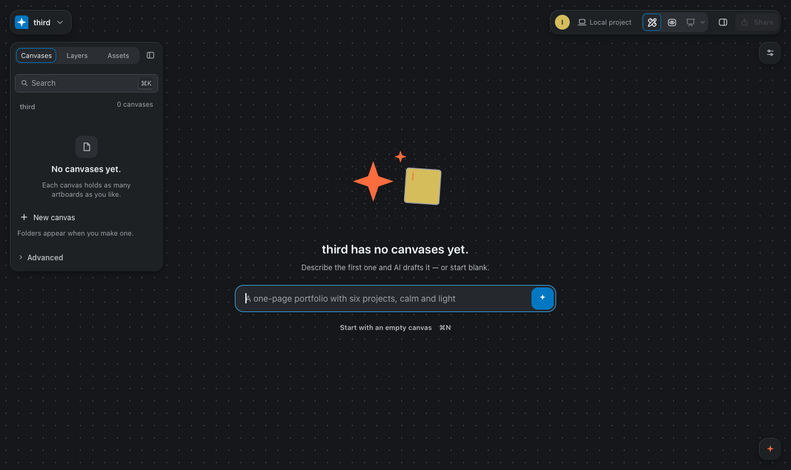

# project-tabs-cap (native-desktop)

Run: 2026-11-05T04:56:50.084Z

| # | Step | Screenshot |
|---|------|------------|
| 1 | 1-three-running |  |
| 2 | 2-fourth-rests-one |  |
| 3 | 3-idle-rested |  |
| 4 | 4-woken |  |
